<a id="top"></a>

<!-- Generated by readme-builder; edit the JSON/content source. -->

<p align="center"><picture><source media="(prefers-color-scheme: dark)" srcset="assets/readme-builder/es/hero-dark.svg" /></picture></p>

<p align="center"><strong>La primera impresión de tu próximo repositorio, hecha con intención.</strong></p>

<p align="center"><a href="#inicio">Empieza con un repositorio real</a> · <a href="#componentes">Un sistema visual pequeño y propio</a> · <a href="#migrar">Conserva el README. Mejora su presentación.</a></p>

<p align="center"><a href="README.md">English</a> · <a href="README.es.md">Español</a></p>

- **Primero el contenido.** Escribe a partir del repositorio real. Conserva los comandos, los límites y los detalles que importan.
- **Un lenguaje visual.** Iconos originales, secciones numeradas, banners y widgets reutilizables. SVG locales, bajo tu control.
- **Siempre tuyo.** Sin servicio de render, clave de API ni paquetes en ejecución. Guarda los recursos en Git y listo.

<a id="inicio"></a>

##  Empieza con un repositorio real

**Python 3.11+ y Git. Nada más para ejecutar el generador.**

```sh
git clone https://github.com/robgallardof/readme-builder.git
cd readme-builder
python -m readme_builder build examples/project.json --output demo
```

Abre `demo/README.md` y edita una copia de [la configuración de ejemplo](examples/project.json).
Define nombre, descripción, tema, idioma y secciones. El contenido puede escribirse
directamente en JSON o leerse desde archivos Markdown locales. Consulta el
[contrato de autoría](docs/CONFIGURATION.md).

La carpeta de salida contiene Markdown y SVG portables. Copia los archivos generados
a tu proyecto o genera allí después de revisar las rutas. El generador rechaza
sobrescribir archivos que no le pertenecen; `--force` es una excepción explícita.

<a id="componentes"></a>

##  Un sistema visual pequeño y propio

| Componente | Para qué sirve |
|---|---|
| **Hero** | Marca geométrica propia, identidad clara y una promesa breve. Variantes claras y oscuras. |
| **Sección** | Franjas numeradas con iconos de línea, encabezados reales y anclas estables. |
| **Separador** | Una línea con degradado que separa ideas sin recargar la página. |
| **Características** | Hasta seis tarjetas con beneficios escritos por ti e iconos propios. |
| **Terminal** | Un ejemplo mostrado como widget; nunca una ejecución inventada. |
| **Métricas** | Hasta cuatro datos declarados. Si son mediciones, conserva su evidencia. |
| **Flujo** | Una secuencia compacta de hasta seis pasos. |
| **Pie** | Una firma final que comparte el lenguaje visual. |

Tres paletas: **Aurora** (violeta/cian), **Ember** (naranja/rosa), **Ocean** (azul/verde).
Los componentes y los iconos originales tienen licencia MIT. Incluye **39 iconos Lucide** con sus avisos ISC / MIT ([atribución](THIRD_PARTY_NOTICES.md)). Sin fuentes remotas, scripts,
píxeles de seguimiento ni servidores externos de imágenes. Consulta los iconos:

```sh
python -m readme_builder icons
```

La [guía de componentes](docs/COMPONENTS.md) describe límites de texto y revisión visual.

### Movimiento y alineacion

Las filas de banners, widgets, separadores y pies se generan centradas. El modo
`"motion": "subtle"` es el predeterminado: dos recorridos decorativos que terminan
en cuatro segundos. El texto y los datos no se desplazan. `"ambient"` usa un efecto
continuo lento; `"off"` genera SVG estaticos. Se respeta `prefers-reduced-motion`.

```sh
python -m readme_builder animate assets/banner.svg                # vista previa
python -m readme_builder animate assets/banner.svg --write
python -m readme_builder animate assets/banner.svg --preset off --write
```

Usa nombres como `lucide-brain-circuit`, `lucide-shield-check`,
`lucide-clapperboard` o `lucide-layout-template`. Los iconos son locales:
sin CDN ni JavaScript. Las animaciones SVG/SMIL existentes se conservan.

La firma es optativa: indica tu logo y perfil en `branding`. La firma queda al final. Cuando se pida un diagrama, prioriza Archify e importa sus SVG claros y oscuros ya verificados.

Los titulos y las descripciones usan Markdown para adaptarse al ancho disponible. Solo el fondo de la portada tiene movimiento: los separadores, iconos, diagramas y la firma de cierre permanecen estaticos.

<a id="migrar"></a>

##  Conserva el README. Mejora su presentación.

Si ya tienes un README que te gusta, empieza con una simulación:

```sh
python -m readme_builder migrate /ruta/al/proyecto/README.md
python -m readme_builder migrate /ruta/al/proyecto/README.md --write
python -m readme_builder check /ruta/al/proyecto
```

Los emojis decorativos y los shortcodes reconocidos se convierten en iconos SVG locales.
Los ejemplos dentro de bloques de código y el código en línea permanecen intactos.
Las etiquetas de Mermaid pasan a texto limpio porque no admiten estas imágenes de
forma portable. Se conservan alias de los encabezados, UTF-8 BOM y saltos CRLF/LF.

La auditoría detecta enlaces locales rotos, conflictos de merge y emojis decorativos
restantes. No visita enlaces remotos ni demuestra que las afirmaciones del proyecto
sean ciertas. Revisa el diff en Markdown complejo: es un escáner conservador, no un
parser completo. Conserva un commit antes de una migración grande.

<a id="agentes"></a>

##  Trae a tu agente. Conserva tu criterio.

Entrega el repositorio y [el prompt maestro](prompts/README-DESIGNER.md) a tu agente.
Pídele revisar comandos, pruebas y limitaciones reales antes de escribir. El prompt
produce un inventario de evidencia, una estructura editorial y el JSON del generador.

| Trabajo | Instrucción reutilizable |
|---|---|
| Diseñar un README nuevo | [Diseñador de README](prompts/README-DESIGNER.md) |
| Mejorar uno existente | [Migración de presentación](prompts/MIGRATE.md) |
| Revisar el resultado | [Revisión editorial y visual](prompts/REVIEW.md) |

[AGENTS.md](AGENTS.md) explica cómo contribuir a esta herramienta. Los
[contratos de roles](agents/README.md) separan evidencia, redacción y revisión visual.
No instalan hooks, cambian configuraciones globales ni lanzan agentes automáticamente.

<a id="flujo"></a>

##  Escribe. Genera. Revisa.

```sh
# Genera los README del builder en inglés y español.
python -m readme_builder build readme.json --output .

# Detecta archivos desactualizados sin escribir.
python -m readme_builder build readme.json --output . --check

# Revisa enlaces locales, anclas y presentación.
python -m readme_builder check .

# Crea una hoja local de componentes en ambos modos de color.
python -m readme_builder preview . --output preview.html
```

Edita `readme.json` y `content/`, y vuelve a generar. Un manifiesto SHA-256 protege
los archivos generados frente a cambios manuales accidentales. Detecta cambios y
pertenencia; no es una firma ni sustituye a Git. El generador no elimina recursos antiguos.

`audit RUTA --json` entrega un informe estructurado. `audit` informa sin fallar;
`check` devuelve 1 si encuentra problemas. Las entradas inválidas devuelven 2.

El diagrama se generó y verificó con [Archify](https://github.com/tt-a1i/archify). La fuente y los avisos de las exportaciones están en [assets/diagrams](assets/diagrams).

<p align="center"><picture><source media="(prefers-color-scheme: dark)" srcset="assets/readme-builder/es/diagram-05-dark.svg" /></picture></p>

<a id="limites"></a>

##  Qué promete esta herramienta

- Generador y sistema visual local, sin servicio de IA integrado.
- Los prompts orientan al agente; el programa no los ejecuta ni corre comandos del proyecto.
- La vista previa es una hoja de componentes. GitHub sigue siendo el render final de Markdown.
- El texto SVG usa fuentes del sistema. Los límites de autoría evitan recortes silenciosos.
- Los archivos fuente, métricas declaradas y comandos de ejemplo son responsabilidad del autor.
- Las métricas locales son estáticas; no simulan estadísticas de GitHub en tiempo real.
- No publica repositorios en lote. El commit y push se hacen en el proyecto elegido.

La dirección visual nace de [Rekora](https://github.com/robgallardof/rekora),
[RepoRinse](https://github.com/robgallardof/RepoRinse) y
[el perfil de Roberto](https://github.com/robgallardof). El template no incluye
contenido privado ni la redacción específica de esos proyectos.

<a id="desarrollo"></a>

##  Constrúyelo con nosotros

```sh
python -m unittest discover -s tests -v
python -m readme_builder build readme.json --output . --check
python -m readme_builder check .
```

Las pruebas usan archivos temporales y procesos CLI reales: salida determinista,
protección de cambios, límites de rutas, escape, temas, migración idempotente,
ejemplos de código, Unicode, BOM/CRLF y códigos de error. CI ejecuta las mismas
comprobaciones en Windows, Linux y macOS. Consulta [qué se ejecutó](docs/STATUS.md).

Lee [CONTRIBUTING.md](CONTRIBUTING.md) antes de añadir un componente. Cada componente
debe ser portable, accesible y útil fuera de un solo repositorio.

[MIT](LICENSE) · Iconos y componentes SVG originales de Roberto Gallardo.

<p align="center"><a href="#top">Volver al inicio</a></p>

<!-- readme-builder:signature:start -->
<p align="center"><a href="https://github.com/robgallardof"><picture><source media="(prefers-color-scheme: dark)" srcset="assets/readme-builder/es/footer-dark.svg" /></picture></a></p>
<!-- readme-builder:signature:end -->
