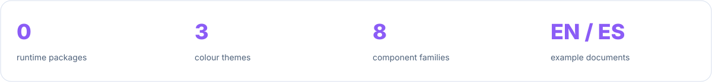
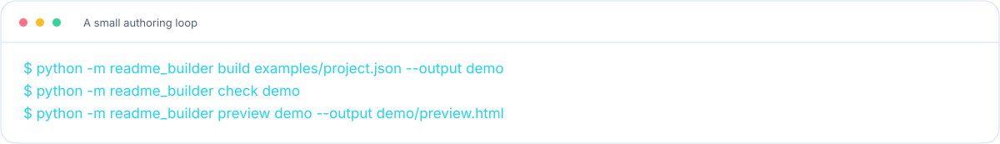

<a id="top"></a>

<!-- Generated by readme-builder; edit the JSON/content source. -->

<picture><source media="(prefers-color-scheme: dark)" srcset="assets/readme-builder/en/hero-dark.svg" /></picture>

<p align="center"><a href="#start">Start with a real repository</a> · <a href="#components">A small, original design system</a> · <a href="#migrate">Keep the README. Upgrade the presentation.</a> · <a href="#agents">Bring your agent. Keep your judgment.</a> · <a href="#workflow">Author. Generate. Review.</a> · <a href="#limits">What this tool promises</a> · <a href="#develop">Build it with us</a></p>

<p align="center"><a href="README.md">English</a> · <a href="README.es.md">Español</a></p>

<picture><source media="(prefers-color-scheme: dark)" srcset="assets/readme-builder/en/features-dark.svg" /></picture>

<picture><source media="(prefers-color-scheme: dark)" srcset="assets/readme-builder/en/metrics-dark.svg" /></picture>

<picture><source media="(prefers-color-scheme: dark)" srcset="assets/readme-builder/en/terminal-dark.svg" /></picture>


<a id="start"></a>
<h2><picture><source media="(prefers-color-scheme: dark)" srcset="assets/readme-builder/en/section-01-dark.svg" /></picture></h2>

**Python 3.11+ and Git. Nothing else to run the generator.**

```sh
git clone https://github.com/robgallardof/readme-builder.git
cd readme-builder
python -m readme_builder build examples/project.json --output demo
```

Open `demo/README.md` and edit a copy of [the example configuration](examples/project.json).
Set the name, tagline, colour theme, language and sections; write section copy inline
or load it from a local Markdown file. See the [authoring contract](docs/CONFIGURATION.md).

The `--output` directory contains portable Markdown and SVG files. Copy those generated
files into your project, or generate there directly after reviewing the output paths.
The CLI refuses to overwrite files it does not own. `--force` is an explicit override.


<a id="components"></a>
<h2><picture><source media="(prefers-color-scheme: dark)" srcset="assets/readme-builder/en/section-02-dark.svg" /></picture></h2>

| Component | Designed for |
|---|---|
| **Hero** | An original geometric mark, clear identity and a short promise. Explicit light/dark variants. |
| **Section** | Numbered bands with line icons, real heading semantics and stable anchors. |
| **Divider** | A quiet gradient rule to separate ideas without visual noise. |
| **Features** | Up to six cards, with authored benefits and their own icons. |
| **Terminal** | A copyable example shown as a terminal widget; no invented execution result. |
| **Metrics** | Up to four declared facts. Use measurements only when you have their evidence. |
| **Pipeline** | A compact sequence of up to six steps. |
| **Footer** | A matching closing signature. |

Three palettes: **Aurora** (violet/cyan), **Ember** (orange/rose), **Ocean** (blue/teal).
All artwork is original, MIT licensed, and stored in the repository. No remote fonts,
scripts, tracking pixels or third-party image rendering. List the icon vocabulary:

```sh
python -m readme_builder icons
```

See the [component guide](docs/COMPONENTS.md) for layout limits and preview instructions.


<a id="migrate"></a>
<h2><picture><source media="(prefers-color-scheme: dark)" srcset="assets/readme-builder/en/section-03-dark.svg" /></picture></h2>

Already have a README you like? Start with a dry run:

```sh
python -m readme_builder migrate /path/to/project/README.md
python -m readme_builder migrate /path/to/project/README.md --write
python -m readme_builder check /path/to/project
```

Decorative Unicode emoji and supported shortcodes become local line icons. Ordinary
fenced examples and inline code remain unchanged. Mermaid labels become plain text,
because image HTML is not portable inside those labels. Heading aliases preserve
existing navigation. UTF-8 BOM and CRLF/LF are retained.

The audit reports broken local links, unresolved merge markers and remaining decorative
emoji. It does not fetch remote links or decide whether a project's claims are true.
For complex nested Markdown, review the diff: this is a conservative scanner, not a
complete Markdown parser. Keep a Git commit before applying a large migration.


<a id="agents"></a>
<h2><picture><source media="(prefers-color-scheme: dark)" srcset="assets/readme-builder/en/section-04-dark.svg" /></picture></h2>

Give an agent the repository and [the master prompt](prompts/README-DESIGNER.md).
Ask it to inspect actual commands, tests and limitations before writing copy. The
prompt produces an evidence inventory, a content structure and a generator config.

| Task | Reusable brief |
|---|---|
| Design a new README | [README designer](prompts/README-DESIGNER.md) |
| Upgrade an existing README | [Presentation migration](prompts/MIGRATE.md) |
| Review the result | [Editorial and visual review](prompts/REVIEW.md) |

[AGENTS.md](AGENTS.md) describes how to contribute to this tool. The
[role contracts](agents/README.md) help separate evidence, copy and visual review.
They do not install hooks, edit global settings or automatically spawn other agents.


<a id="workflow"></a>
<h2><picture><source media="(prefers-color-scheme: dark)" srcset="assets/readme-builder/en/section-05-dark.svg" /></picture></h2>

```sh
# Generate the builder's own English and Spanish READMEs.
python -m readme_builder build readme.json --output .

# Detect stale generated files without writing.
python -m readme_builder build readme.json --output . --check

# Audit local links, anchors and presentation.
python -m readme_builder check .

# Make a local component proof sheet, including both colour modes.
python -m readme_builder preview . --output preview.html
```

Edit `readme.json` and `content/`, then rebuild. A SHA-256 ownership manifest protects
generated files from accidental replacement of manual edits. It is a drift/ownership
guard, not a signature or a substitute for Git. Generation does not delete stale assets.

Use `audit ROOT --json` for a machine-readable review. `audit` reports findings and exits
successfully; `check` exits 1 if any finding remains. Invalid input exits 2.


<a id="limits"></a>
<h2><picture><source media="(prefers-color-scheme: dark)" srcset="assets/readme-builder/en/section-06-dark.svg" /></picture></h2>

- A local generator and design system, with no AI service built into the runtime.
- Prompts guide an agent; the generator does not execute them or run repository commands.
- The preview is a component contact sheet. GitHub remains the final Markdown renderer.
- SVG text uses system fonts. Long visual copy is bounded rather than silently clipped.
- Source files, authored metrics and example commands stay your responsibility.
- Local badges and metrics are static. Nothing pretends to be a live GitHub statistic.
- No bulk repository publishing. Commit and push from the project you intend to update.

The visual direction comes from [Rekora](https://github.com/robgallardof/rekora),
[RepoRinse](https://github.com/robgallardof/RepoRinse) and
[Roberto's profile](https://github.com/robgallardof). Their project-specific copy and
private repository material are not bundled into this template.


<a id="develop"></a>
<h2><picture><source media="(prefers-color-scheme: dark)" srcset="assets/readme-builder/en/section-07-dark.svg" /></picture></h2>

```sh
python -m unittest discover -s tests -v
python -m readme_builder build readme.json --output . --check
python -m readme_builder check .
```

Tests use actual temporary files and CLI subprocesses: deterministic output, overwrite
protection, path boundaries, escaping, colour themes, migration idempotence, code fences,
Unicode, BOM/CRLF and error exits. CI runs the same checks on Windows, Linux and macOS.
See [verification status](docs/STATUS.md) for what actually ran.

Read [CONTRIBUTING.md](CONTRIBUTING.md) before adding a component. Keep new components
portable, accessible and useful outside a single repository.

[MIT](LICENSE) · Original icons and SVG components by Roberto Gallardo.

<picture><source media="(prefers-color-scheme: dark)" srcset="assets/readme-builder/en/footer-dark.svg" /></picture>

<p align="center"><a href="#top">Back to top</a></p>
