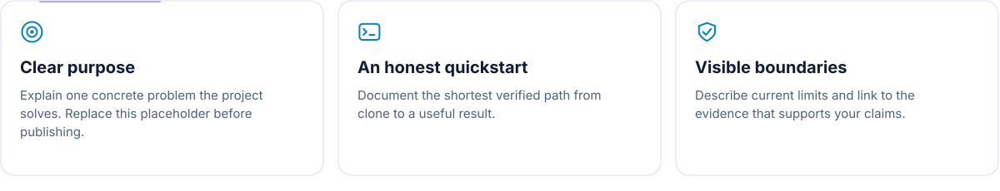
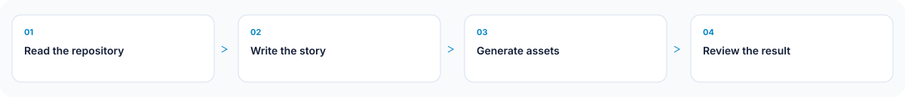
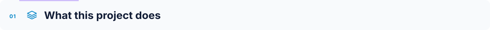
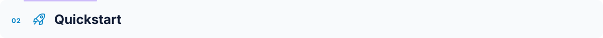
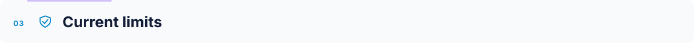

<a id="top"></a>

<!-- Generated by readme-builder; edit the JSON/content source. -->

<picture><source media="(prefers-color-scheme: dark)" srcset="assets/readme-builder/en/hero-dark.svg" /></picture>

<p align="center"><a href="#overview">What this project does</a> · <a href="#start">Quickstart</a> · <a href="#limits">Current limits</a></p>

<picture><source media="(prefers-color-scheme: dark)" srcset="assets/readme-builder/en/features-dark.svg" /></picture>

<picture><source media="(prefers-color-scheme: dark)" srcset="assets/readme-builder/en/pipeline-dark.svg" /></picture>


<a id="overview"></a>
<h2><picture><source media="(prefers-color-scheme: dark)" srcset="assets/readme-builder/en/section-01-dark.svg" /></picture></h2>

Replace this paragraph with the intended user, the problem, and the resulting behaviour. This is an authoring template, not an implemented product.


<a id="start"></a>
<h2><picture><source media="(prefers-color-scheme: dark)" srcset="assets/readme-builder/en/section-02-dark.svg" /></picture></h2>

List real requirements and commands you have verified. Label anything not executed.

```sh
# Replace with your project's verified setup command.
```


<a id="limits"></a>
<h2><picture><source media="(prefers-color-scheme: dark)" srcset="assets/readme-builder/en/section-03-dark.svg" /></picture></h2>

List the boundaries that matter to a user making a decision. Avoid unsupported performance or compatibility claims.

<picture><source media="(prefers-color-scheme: dark)" srcset="assets/readme-builder/en/footer-dark.svg" /></picture>

<p align="center"><a href="#top">Back to top</a></p>
